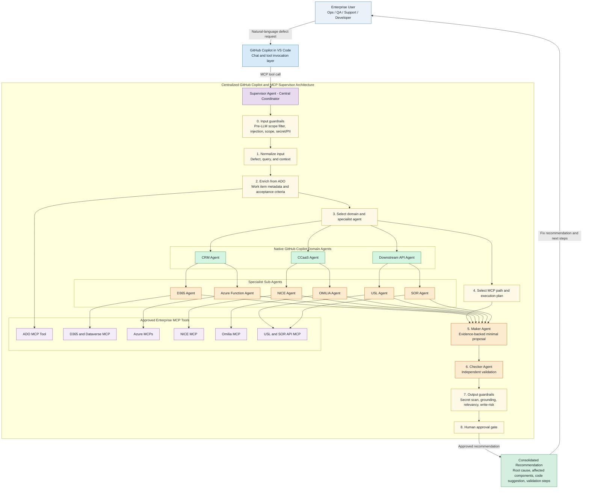

# Copilot Resolution Hub

> **Leadership Presentation Summary** — An enterprise-grade, AI-native defect resolution platform built entirely on GitHub Copilot's native multi-agent framework, requiring zero custom orchestration code.

## Executive Summary

Enterprise support and engineering teams spend significant time triaging defects across multiple systems — CRM (D365), CCaaS (NICE / Omilia), and downstream APIs — before a root cause and fix can be proposed. This investigation typically requires navigating siloed tools, reading through logs, querying Dataverse, and coordinating across teams.

**Copilot Resolution Hub** solves this by deploying a governed, multi-agent AI architecture directly inside GitHub Copilot in VS Code. When a developer or support analyst submits an ADO Bug ID or User Story, the system:

1. Applies **input guardrails** — a deterministic pre-LLM scope filter rejects off-topic requests before any model call, plus prompt-injection, secret/PII, and scope checks.
2. Automatically routes the defect to the correct domain agent (CRM, CCaaS, or API).
3. Gathers authoritative evidence from approved enterprise MCPs (D365, NICE, Omilia, Azure, ADO).
4. Produces a bounded, evidence-backed fix recommendation via a **Maker Agent**.
5. Independently validates that recommendation via a **Checker Agent**.
6. Applies **output guardrails** (secret scan, evidence grounding, relevancy, write-risk) and a **human approval gate** before any fix is actioned in production.

### Key Business Outcomes

| Outcome | Detail |
| --- | --- |
| Faster defect resolution | Automated triage, routing, and evidence gathering replaces manual cross-system investigation |
| Consistent quality | Maker/Checker separation enforces evidence-backed proposals — no hallucinated root causes |
| Governed AI usage | MCP Inspector approval gates ensure only verified tools are used as evidence sources |
| Guarded I/O | Input/output guardrails block off-topic and unsafe requests pre-LLM, and gate ungrounded, irrelevant, or secret-leaking output before delivery |
| Zero new infrastructure | Runs natively in GitHub Copilot; no new servers, orchestration pipelines, or ML models to maintain |
| Reusable knowledge | Validated bug-fix procedures are promoted to a shared learning library after each resolution |
| Audit-ready | Every recommendation includes a baseline, hypothesis, scope, risk, and validation plan |

---

Native GitHub Copilot multi-agent architecture for enterprise defect analysis, code-fix recommendations, and future automation across CRM, CCaaS, and downstream API systems.

## Centralized Copilot and MCP Supervisor Architecture



## Stakeholder Walkthrough

1. An enterprise user submits an ADO Bug ID, User Story ID, change request, or requirement through GitHub Copilot.
2. **Input guardrails** run first: a deterministic Layer 0 pre-LLM scope filter returns a canned reply for off-topic requests without a model call, then prompt-injection, scope allow-list, and secret/PII checks validate the request before routing.
3. The Supervisor Agent normalizes the request and uses the ADO MCP to obtain authoritative work-item context.
3. The Supervisor Agent selects the CRM, CCaaS, or Downstream API domain agent.
4. The domain agent delegates the technical investigation to its specialist sub-agent.
5. The specialist uses its matching MCP to gather authoritative evidence for the Maker Agent.
6. The Maker Agent produces a bounded, evidence-backed proposal and a versioned handoff containing the baseline, primary metric, scope, hypothesis, risks, and validation plan.
7. The Checker Agent independently verifies evidence and runs the narrowest checks that can falsify the proposal. It returns `validated`, `rejected`, `blocked`, or `needs_human_approval`; it never rewrites the Maker proposal.
9. The Supervisor consolidates the Checker verdict, applies **output guardrails** (secret scan, evidence grounding, relevancy, write-risk, output contract), then applies the human approval gate before returning the final recommendation.

## Domain Routing

| Domain | Specialist agents | Evidence source |
| --- | --- | --- |
| CRM | D365 Agent, Azure Function Agent | D365/Dataverse MCP, Azure MCPs |
| CCaaS | NICE Agent, OMILIA Agent | NICE MCP, Omilia MCP |
| Downstream API | USL Agent, SOR Agent | USL/SOR API MCP |

## Architecture Principles

- GitHub Copilot Custom Agents and Markdown-based definitions provide the orchestration behavior.
- Skills encapsulate repeatable triage, routing, MCP governance, input/output guardrails, fix recommendation, and approval workflows.
- Input/output guardrails apply a hybrid policy: hard-block on security violations (injection, secret/PII, out-of-scope, unapproved writes); flag-and-escalate on quality violations (weak grounding, irrelevant answer, malformed contract). A deterministic pre-LLM scope filter rejects off-topic requests without spending a model call.
- MCPs provide system evidence; agents do not invent unsupported root causes.
- The Supervisor coordinates and summarizes. Domain and specialist agents route and gather domain evidence.
- Maker and Checker are separate sub-agents: the Maker proposes and cannot self-certify; the Checker independently validates and cannot silently rewrite the proposal.
- Defect work establishes a baseline and falsifiable hypothesis; development work establishes observable acceptance criteria and a primary metric before implementation.
- The feedback loop stores Checker evaluation records, curates validated lessons through reviewable pull requests, and promotes knowledge only with evidence and an owner.
- After each validated bug fix, the workflow records a reusable procedure lesson in `.github/skills/fix-recommendation/PROCEDURE-LEARNING.md`.
- A bug fix is not considered complete until repository unit tests pass (or the task is explicitly blocked with evidence when tests are unavailable).
- Auto mode uses complexity-based routing: low and medium tasks use default mini-model agents, while high-complexity tasks trigger Maker/Checker re-validation on a higher-capability model before final recommendation.
- MCP Inspector is used to approve and periodically re-inspect MCP server/tool contracts, not as a per-task agent dependency.
- High-risk, low-confidence, production, security, data-integrity, and cross-system changes require human approval.
- Each defect run is observable: agents emit a structured run-record (one trace per work item, one span per agent hop, guardrail verdict, MCP evidence call, Maker/Checker step, and model escalation) that is exported to Logfire or any OpenTelemetry (OTLP) backend. Observability is post-hoc telemetry only and does not participate in routing.
- No Python orchestration, LangGraph, Semantic Kernel, or custom routing/classifier source code is used. The only executable code is a standalone telemetry exporter (`observability/emit_traces.py`), kept outside the agent decision flow.

## Implemented Agent Controls

| Control | Implementation | Purpose |
| --- | --- | --- |
| Operating modes | [copilot-instructions.md](copilot-instructions.md) | Keeps defect and development success criteria separate: baseline and falsifiable hypothesis for defects; acceptance metric and fixed constraints for development. |
| Maker proposal | [Maker Agent](.github/agents/maker-agent.md) | Produces the smallest evidence-backed change proposal and a versioned YAML handoff. |
| Checker verdict | [Checker Agent](.github/agents/checker-agent.md) | Independently verifies Maker evidence, the primary metric, negative checks, scope, and approval gates. |
| Feedback and learning | [Reliability and Learning Design](docs/agent-reliability-learning-design.md) | Defines append-only evaluation records, metrics, knowledge promotion, and rollback rules. |
| MCP inspection | [MCP Governance Skill](.github/skills/mcp-governance/SKILL.md) and [MCP Inspection Inventory](docs/mcp-inspection-inventory.md) | Governs MCP Inspector testing, tool approval, Maker/Checker access, and safe evidence handling. |
| Input/output guardrails | [I/O Guardrails Skill](.github/skills/io-guardrails/SKILL.md) | Deterministic pre-LLM scope filter plus input (injection, scope, secret/PII) and output (secret scan, grounding, relevancy, write-risk, contract) checks under a hybrid block/escalate policy. |
| Agent observability | [Agent Observability Skill](.github/skills/agent-observability/SKILL.md) and [observability/](observability/README.md) | Emits one OpenTelemetry trace per defect run (span per agent hop, guardrail, MCP call, Maker/Checker step, model escalation) to Logfire or any OTLP backend, with mandatory secret/PII redaction before export. |
| AI governance policy | [AI Governance](docs/ai-governance.md) | Consolidates all controls under NIST AI RMF (Govern/Map/Measure/Manage) with RACI, data/model governance, incident response, and tracked gaps. |

## Repository Contents

- [copilot-instructions.md](copilot-instructions.md): global operating rules and deployment architecture.
- [.github/agents](.github/agents): supervisor, domain, and specialist agent definitions.
- [.github/skills](.github/skills): repeatable multi-agent workflows and governance skills, including the [I/O Guardrails Skill](.github/skills/io-guardrails/SKILL.md) and the [Agent Observability Skill](.github/skills/agent-observability/SKILL.md).
- [observability/](observability/README.md): OpenTelemetry/Logfire trace exporter (`emit_traces.py`), run-record schema, and example — turns agent run-records into distributed traces.
- [docs/enterprise-agent-architecture.md](docs/enterprise-agent-architecture.md): detailed architecture guidance.
- [docs/ai-governance.md](docs/ai-governance.md): consolidated AI governance policy mapped to NIST AI RMF (roles, data/model policy, incident response, tracked gaps).
- [docs/agent-reliability-learning-design.md](docs/agent-reliability-learning-design.md): Maker/Checker separation, evaluation metrics, learning loop, and adoption plan.
- [docs/mcp-inspection-inventory.md](docs/mcp-inspection-inventory.md): MCP Inspector approval record for server and tool contracts.
- [docs/repository-registry.md](docs/repository-registry.md): approved repositories and branches for source-code investigation.
- [docs/target-deployment-architecture.png](docs/target-deployment-architecture.png): stakeholder deployment architecture image.

## Current Status

| Area | Status |
| --- | --- |
| Supervisor + Domain Agents (CRM, CCaaS, API) | Implemented |
| Specialist Sub-Agents (D365, Azure Function, NICE, Omilia, USL, SOR) | Implemented |
| Maker Agent (evidence-backed proposal) | Implemented |
| Checker Agent (independent validation) | Implemented |
| Human Approval Gate | Implemented |
| Input/Output Guardrails (pre-LLM scope filter, grounding, relevancy) | Implemented |
| Agent Observability (OpenTelemetry/Logfire run-record tracing) | Implemented |
| Skills (triage, routing, MCP governance, I/O guardrails, observability, fix recommendation, human approval) | Implemented |
| ADO MCP integration | Implemented |
| D365 / Dataverse MCP integration | Implemented |
| USL Automation MCP integration | Implemented |
| PAC MCP (Power Platform CLI) | Implemented |
| MCP Inspection Inventory | Implemented |
| Agent Reliability and Learning Loop | Implemented |
| Repository Registry (approved source branches) | Implemented |

## Live Demo Flow (Presentation)

> Use GitHub Copilot Chat in VS Code with Agent mode enabled.

1. Open GitHub Copilot Chat and switch to **Agent** mode.
2. Type a prompt such as:
   > `Analyse ADO bug 879652 and provide a fix recommendation.`
3. The **Supervisor Agent** normalises the request and enriches it from ADO.
4. Observe automatic routing to the correct domain agent → specialist → MCP evidence gathering.
5. The **Maker Agent** produces an evidence-backed proposal with scope, hypothesis, risks, and validation steps.
6. The **Checker Agent** independently validates and returns a verdict.
7. The final recommendation (with human approval status) is returned to the user.

### Demo Tips
- Bug IDs from the `temp/bug879652/` folder are pre-staged for live demonstration.
- The `docs/enterprise-bug-end-to-end-prompts.md` file contains ready-to-use prompt templates.
- Use `docs/usl-bug-end-to-end-prompts.md` for USL/API-domain demos.
- **One-liner for team adoption:** `Analyse ADO bug <ID> and provide a fix recommendation.` — the agent handles everything else. No prompt engineering required from the team.

---

## MCP Quick Start (Team)

- Shared MCP config is in [.vscode/mcp.json](.vscode/mcp.json).
- Before an MCP server or tool is used as Maker/Checker evidence, inspect and approve it through the [MCP Inspection Inventory](docs/mcp-inspection-inventory.md). MCP Inspector is an onboarding and change-control client, not a server added to `.vscode/mcp.json`.
- Run MCP Inspector from the repository root with `npx @modelcontextprotocol/inspector`, connect using the transport and approved authentication method from `.vscode/mcp.json`, and record only non-sensitive results in the inventory.
- For Power Apps and Dataverse operations, start with `pac-mcp`.
- For Azure DevOps work items, code search, and pipelines, use `ado-remote-mcp`.
- If `pac-mcp` fails on a teammate machine, use fallback entries in this order: `pac-mcp-pac-cli`, then `pac-mcp-dnx`.
- Prerequisites for PAC entries: .NET 10 in user profile and PAC CLI tool installed for that user.
- After pulling latest changes, reload VS Code window once so MCP server list refreshes.

## Observability Quick Start (Team)

- Full details: [observability/README.md](observability/README.md) and the [Agent Observability Skill](.github/skills/agent-observability/SKILL.md).
- Install once: `pip install -r observability/requirements.txt`.
- Console mode (no account, good for demos and CI):
  ```powershell
  python observability/emit_traces.py --input observability/examples/run-record.example.json --console
  ```
- Ship to Logfire: set `LOGFIRE_TOKEN`, then run the same command without `--console`.
- Ship to any OTLP backend (Tempo/Jaeger/Honeycomb/Azure Monitor): set `OTEL_EXPORTER_OTLP_ENDPOINT`, add `--otlp`.
- Redaction is mandatory before emit: never place secrets, PATs, or PII in span names, attributes, or events.