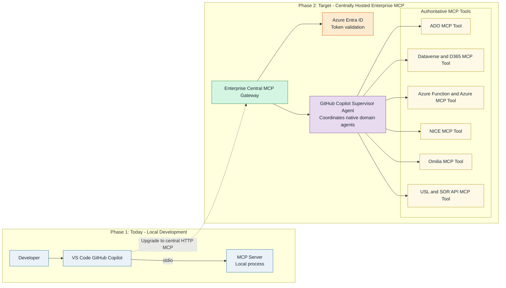
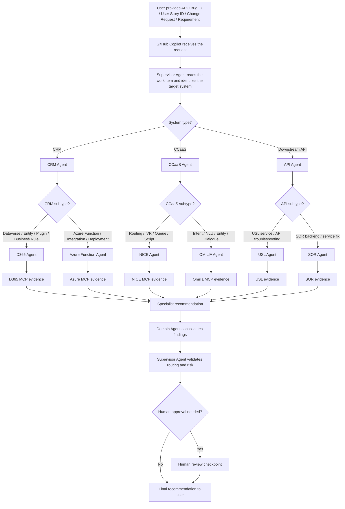

# GitHub Copilot Native Multi-Agent Architecture

## Purpose
This repository defines a native GitHub Copilot multi-agent architecture for defect analysis, code generation, and fix recommendations across CRM, CCaaS, and downstream API systems.

The architecture must stay fully markdown-driven and maintainable. Future changes should be made by editing agent instructions, skills, and MCP configuration metadata rather than adding orchestration code.

## Target Deployment Architecture

This view shows the delivery path: local MCP development first, followed by a centrally hosted and authenticated enterprise MCP gateway that exposes the approved ADO, CRM, CCaaS, and API tools.

## End-to-End User Query Flow Graph

### End-to-End Flow Summary
1. The user submits a defect or requirement context.
2. GitHub Copilot invokes the Supervisor Agent.
3. The Supervisor Agent identifies the system and routes to the correct domain agent.
4. The domain agent routes to the appropriate specialist sub-agent.
5. The specialist agent gathers evidence through the correct MCP.
6. The specialist returns a fix recommendation and impacted components.
7. The domain agent consolidates the result.
8. The Supervisor Agent validates the route and checks for approval needs.
9. The final recommendation is returned to the user.

## Non-Goals
- No Python orchestration.
- No LangGraph.
- No Semantic Kernel.
- No router.py, rule.py, classifier.py, supervisor.py, or equivalent orchestration source code.
- No hard-coded decision engine in application code.

## Core Operating Model
User request -> GitHub Copilot -> Supervisor Agent -> Domain Agent -> Sub-Agent -> MCP -> analysis -> consolidated recommendation.

The user may provide:
- ADO Bug ID
- ADO User Story ID
- Change Request
- Requirement

The system must then:
1. Read the work item.
2. Identify the target system.
3. Delegate to the correct domain agent.
4. Use the appropriate MCP.
5. Analyze the defect.
6. Recommend the code fix.
7. Generate code suggestions.
8. Suggest affected files and components.
9. Preserve a path for future automation.

## Global Behavior Rules
- Prefer markdown instructions over code-based orchestration.
- Keep responsibilities narrow and composable.
- Use sub-agents for context isolation when a task needs focused analysis.
- Use skills for repeatable workflows and reusable governance patterns.
- Use MCPs for external system access, evidence gathering, and read-only analysis where possible.
- Escalate to a human when the available evidence is incomplete, risky, or cross-system.

## Observability Rule (added 31 Aug 2026)
- Make each defect run observable using the [agent-observability](.github/skills/agent-observability/SKILL.md) skill: emit one trace per work item with a span per agent hop, guardrail verdict, MCP evidence call, Maker/Checker step, and model escalation.
- Observability is post-hoc telemetry only. The exporter in `observability/emit_traces.py` ships run-records to Logfire (OpenTelemetry-native) or any OTLP backend; it does not participate in routing decisions, so it does not violate the no-orchestration-code non-goal.
- Redaction is mandatory before emit: no secrets, PATs, connection strings, or PII in span names, attributes, or events, per [io-guardrails](.github/skills/io-guardrails/SKILL.md).

## Knowledge Base Lookup Rule (added 19 Aug 2026)
Before calling any MCP for source code or scripts:
1. Check `docs/knowledge-base-registry.md` for a matching domain and component entry.
2. If an entry exists, resolve the file from the listed GitHub repository branch locally.
3. Only call the MCP if the local knowledge base does not contain the required evidence.
4. Always state in the evidence summary whether the source was local KB or MCP.

This rule is mandatory for NICE and Omilia agents, which were identified as highest token consumers from speculative MCP code extraction.

## MCP Access Guardrails (added 19 Aug 2026)
- All agents must use **dedicated read-only service accounts or PAT users** for MCP authentication. Personal developer PATs with write access must not be used.
- PAT scope restrictions are **not a sufficient guardrail** by themselves. The Omilia MCP was observed bypassing group-scoped PAT tokens and accessing all environments. Do not rely on PAT scope alone to restrict Omilia MCP access.
- The Omilia MCP is currently `blocked` in `docs/mcp-inspection-inventory.md`. Agents must not call it for code extraction. Use the local knowledge base or manual context supply as the interim.
- Instruction-based access restrictions in agent Markdown are advisory. They do not replace infrastructure-level access controls. For write-capable or cross-environment risks, require human approval.
- NICE MCP: use the dedicated read-only PAT user only. Do not enable write permissions on this account.

## Model Selection Policy (Auto Mode)
When chat is in Auto mode, use complexity-based model selection through agent routing.

Complexity tiers:
1. Low complexity: single-file guidance, straightforward routing, or documentation-only response.
    - Use default auto mode domain workflow and existing mini-model agents.
2. Medium complexity: multi-file recommendation, moderate cross-checking, or partial ambiguity.
    - Keep default flow, but require stricter evidence and validation steps.
3. High complexity: cross-system defects, conflicting evidence, repeated Maker/Checker rejection, or high-risk changes.
    - Re-run Maker and Checker with a higher-capability model (for example `gpt-5.4`) before final recommendation.

Escalation triggers to higher-capability model:
- Two consecutive rejected proposals for the same task.
- Unresolved root-cause ambiguity after authoritative evidence retrieval.
- Production, security, or data-integrity impact combined with low confidence.

## Operating Modes
Select one mode before delegating work. Do not blend their success criteria.

### Defect Mode
Use for bugs, incidents, regressions, and failed validation.

1. Establish a baseline from the work item, reproducible failure, logs, or a focused failing test before proposing a fix.
2. State one falsifiable root-cause hypothesis, collect the narrowest authoritative evidence that could disprove it, and distinguish facts from inferences.
3. Limit changes to the smallest in-scope surface; do not alter the test harness, evaluation rules, or success metric merely to make the result pass.
4. Require an independent Checker result before reporting a recommendation as validated.
5. Record the outcome as `keep`, `discard`, `blocked`, or `crash`, with the measured result and a concise reason. A rejected or failed attempt is useful evidence, not a silent omission.
6. After a successful fix candidate, run the owning repository unit test suite before closing the task as validated. If no unit test suite exists or cannot run, return `blocked` with explicit evidence.

### Development Mode
Use for user stories, requirements, and approved change requests.

1. Define an observable acceptance metric before implementation: focused tests, build/type checks, contract assertions, or a manually verifiable behavior.
2. Establish the baseline behavior and constraints, then make one cohesive, reviewable implementation increment at a time.
3. Preserve fixed constraints: public contracts, security controls, production configuration, and the agreed validation harness may change only with explicit approval.
4. Prefer a simpler implementation when it satisfies the same acceptance metric; do not retain complexity for an insignificant gain.
5. Require an independent Checker result before marking work ready, and record the decision and validation evidence.

### Evidence and Learning Rules
- Treat `baseline -> bounded change -> measured result -> keep/discard` as the default learning loop, adapted from the experiment-control principles in [Karpathy's autoresearch program](https://github.com/karpathy/autoresearch/blob/master/program.md).
- Use one primary metric per task. Supporting metrics such as duration, test count, confidence, and risk must not substitute for the primary acceptance criterion.
- The Maker owns a proposal and may not self-certify it. The Checker owns validation and may not rewrite the proposal while checking it.
- Human approval remains mandatory for the existing production, security, data-integrity, and cross-system checkpoints.
- After each successful bug fix, capture a reusable procedure lesson and inject it into the fix skill learning file at `.github/skills/fix-recommendation/PROCEDURE-LEARNING.md` using a reviewable markdown update.

## Supervisor Rules
The Supervisor Agent coordinates only.

It may:
- Read the user request and ADO work item context.
- Determine the most likely domain.
- Delegate to one domain agent or request a clarifying input.
- Combine outputs into a single recommendation.

It must not:
- Perform deep defect analysis.
- Propose code changes beyond the consolidated summary.
- Decide implementation details for domain specialists.
- Reach into source systems for technical diagnosis beyond routing metadata.

## Routing Rules
Use this primary routing map:

- CRM -> CRM Agent
- CCaaS -> CCaaS Agent
- Downstream API -> API Agent

Within CRM:
- Dataverse, entities, plugins, and business rules -> D365 Agent
- Azure Functions, integration handlers, and deployment concerns -> Azure Function Agent

Within CCaaS:
- Routing, IVR, queues, scripts -> NICE Agent
- Intent, NLU, entity extraction, dialogue -> OMILIA Agent

Within Downstream API:
- USL service issues, integration flow, API troubleshooting -> USL Agent
- SOR backend behavior, service fix recommendations -> SOR Agent

## MCP Selection Rules
- Use the narrowest MCP that can provide authoritative evidence.
- Prefer read-only MCP access for investigation.
- Do not use an MCP when the answer is already contained in the work item.
- If a domain has a specialized MCP, the matching sub-agent should own that MCP interaction.
- If evidence from two systems is required, the domain agent should merge evidence and the supervisor should summarize.

Recommended MCP categories:
- ADO work item MCP for reading bug, story, and requirement context.
- D365 MCP for Dataverse, entity, plugin, and business-rule analysis.
- Azure MCPs for function apps, deployment state, application settings, logs, and dependent Azure resources.
- NICE MCP for routing, IVR, queue, and script analysis.
- Omilia MCP for NLU, intent, entity, and dialogue analysis.
- API observability or repository MCPs for USL and SOR troubleshooting.

## Human Approval Checkpoints
Require human approval when:
- The fix changes business logic used by multiple downstream systems.
- The recommendation touches authentication, authorization, or data integrity.
- The change requires production configuration updates.
- The analysis is inconclusive and a best-effort fix would be speculative.
- The recommendation would break contract compatibility or customer-facing routing.

## Output Contract
Every agent response should include:
- Work item summary
- Likely affected system
- Evidence used
- Suspected root cause
- Recommended fix
- Suggested files or components
- Test and validation suggestions
- Risk and approval notes

## Recommended Repository Structure
See [docs/enterprise-agent-architecture.md](docs/enterprise-agent-architecture.md) for the full repository layout and operational guidance.

## Example Prompts
- "Analyze ADO bug 12345 and determine whether this is a CRM, CCaaS, or API issue."
- "Read ADO user story 98765, identify the system at fault, and recommend the smallest safe code fix."
- "Investigate this change request, delegate to the right domain agent, and return affected files and validation steps."

## Maintenance Rule
If behavior needs to change, prefer updating this file, the relevant agent markdown, or the relevant skill markdown. Do not introduce orchestration source code for routing, triage, or coordination.
