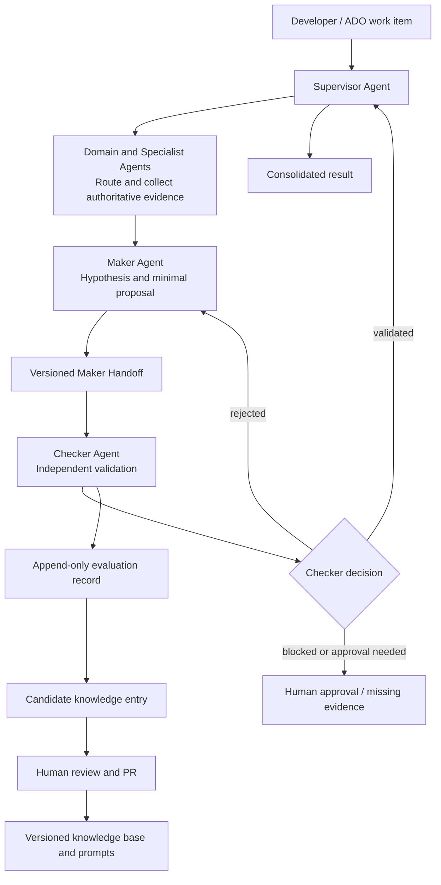

# Agent Reliability, Separation, and Learning Design

## Purpose

This document implements three architecture improvements for the markdown-driven Copilot Resolution Hub:

1. Karpathy-derived operating instructions for defect and development work.
2. Independent Maker and Checker sub-agents with a structured handoff.
3. A measured, governed feedback loop that improves agent guidance without allowing unreviewed self-modification.

## 1. Karpathy-Derived Operating Model

The source is [Karpathy's `autoresearch` `program.md`](https://github.com/karpathy/autoresearch/blob/master/program.md), accessed 2026-08-11. This design adapts its experiment-control principles, rather than copying its research-specific workflow.

| Source principle | Enterprise adaptation |
| --- | --- |
| Constrain the editable surface | Define included and excluded scope plus fixed contracts, security controls, production configuration, and validation harnesses. |
| Fixed, comparable success metric | Select one observable primary metric before work: a reproduction, focused test, acceptance assertion, or contract check. |
| Baseline before experimentation | Capture the pre-change failure or behavior before a recommendation or implementation proposal. |
| One bounded experiment at a time | Make one cohesive proposal per handoff and preserve a reviewable diff. |
| Keep, discard, or crash logging | Record `validated`, `rejected`, `blocked`, or `crash` with evidence; do not lose failed attempts. |
| Simplicity is a quality criterion | Prefer the lowest-complexity proposal that meets the metric and constraints. |
| Advance only on measured improvement | Promote a lesson only after independent validation and governance review. |

The `copilot-instructions.md` Operating Modes section is the canonical system prompt for both modes. The relevant source instruction is adapted, not treated as a mandate to run indefinitely: work remains bounded by task scope, human approvals, and the user’s request.

## 2. Decoupled Maker and Checker Architecture



### Role Boundaries

| Role | May do | Must not do |
| --- | --- | --- |
| Supervisor | Route, preserve task identity, coordinate handoffs, summarize verdicts | Diagnose deeply, author recommendations, override the Checker |
| Domain/Specialist | Gather authoritative evidence and route within its domain | Self-certify a recommendation |
| Maker | Form a falsifiable hypothesis and a minimal proposal | Validate or approve its own proposal |
| Checker | Independently verify evidence, execute scoped checks, decide verdict | Modify the proposal or substitute its own implementation |
| Human approver | Authorize high-risk changes and knowledge promotion | Treat agent confidence as proof |

The implemented prompts are [`.github/agents/maker-agent.md`](../.github/agents/maker-agent.md) and [`.github/agents/checker-agent.md`](../.github/agents/checker-agent.md). The existing supervisor should invoke them sequentially after specialist evidence collection and before final consolidation.

### Handoff Contract

The Maker Handoff and Checker Verdict schemas are deliberately versioned YAML. They provide a stable boundary across separate sub-agent contexts while keeping the current markdown-only implementation model.

Required quality gates:

1. A Maker handoff lacking a baseline or documented reason for its absence is `blocked`.
2. The Checker verifies evidence independently where access exists and reports unverified items explicitly.
3. A proposal is not `validated` unless the primary metric and required negative checks pass.
4. `needs_human_approval` is terminal until a responsible person records an approval decision.
5. A rejected verdict returns the original measured failure to the Maker; the Checker does not repair it.
6. A validated bug-fix verdict requires successful execution of repository unit tests, or the task remains blocked.

## 3. Feedback Loop and Knowledge Base

### Options Considered

| Option | Benefits | Limitations | Decision |
| --- | --- | --- | --- |
| Free-form retrospective in chat | No setup | Not durable, unqueryable, weak audit trail | Reject |
| Automatic prompt self-editing | Fast apparent adaptation | Prompt injection and regression risk; no reviewable provenance | Reject |
| ADO-only fields/comments | Visible to delivery teams | Poor cross-task retrieval and unsuitable for reusable guidance | Use as an outcome link only |
| External vector database with automatic ingestion | Powerful semantic retrieval | New service, access control, ingestion quality, and governance overhead | Defer |
| Versioned Markdown knowledge base plus structured evaluation records | Fits the existing markdown-first architecture; reviewable, auditable, easy to pilot | Manual/PR promotion and less sophisticated retrieval | Recommend now |

### Recommended Feasible Design

Use a hybrid, governed loop:

1. **Capture:** The Checker produces an append-only evaluation record for every completed attempt. Store operational records outside prompts, for example `temp/agent-evaluations/<task-id>.yaml`, with the ADO/work-item link, handoff version, timestamps, metric, checks, verdict, confidence, risk, and hashes/links to evidence. Do not store secrets, customer data, raw production payloads, or credentials.
2. **Evaluate:** A scheduled or human-triggered review aggregates records by task type, domain, mode, and agent/prompt version. It looks for repeated failures, high-value validated patterns, and disagreement between Maker and Checker.
3. **Curate:** For each validated bug fix, the Checker recommends a reusable lesson and the curator promotes it into `.github/skills/fix-recommendation/PROCEDURE-LEARNING.md` after evidence, scope, and sensitivity review. Promotion remains a pull request with an owner, source record links, confidence, review date, and expiry/revalidation date.
4. **Apply:** The Supervisor retrieves only approved, relevant entries by domain and task type. Entries are advisory evidence, never authority to bypass fresh investigation, MCP evidence, tests, or human approval.
5. **Measure again:** Compare the next evaluation window against the established baseline before retaining a prompt or knowledge-base change. Revert a guidance change that worsens key metrics.

### MCP Inspector Control

Before a new MCP server or tool becomes evidence-bearing for a Maker or Checker, inspect it with MCP Inspector and register the result in [MCP Inspection Inventory](mcp-inspection-inventory.md). Inspector validates the server contract, least-privilege access, response behavior, and whether the Checker can independently retrieve the necessary evidence. It is an onboarding and change-control activity, not a required per-task runtime step. The [MCP Governance Skill](../.github/skills/mcp-governance/SKILL.md) contains the approval workflow and data-handling restrictions.

### Evaluation Record Schema

```yaml
record_version: 1
task_id: <identifier>
completed_at_utc: <ISO-8601 timestamp>
mode: defect | development
domain: CRM | CCaaS | API | other
prompt_versions:
  supervisor: <git SHA or version>
  maker: <git SHA or version>
  checker: <git SHA or version>
primary_metric:
  name: <metric name>
  baseline: <value>
  target: <value>
  observed: <value>
maker_status: proposed | blocked | discarded
checker_decision: validated | rejected | blocked | needs_human_approval
checks:
  planned_count: <integer>
  run_count: <integer>
  passed_count: <integer>
  failed_count: <integer>
unit_test_gate:
  command: <command>
  result: pass | fail | blocked
evidence_quality: verified | partially_verified | unverified
rework_cycles: <integer>
human_approval: not_required | pending | approved | rejected
knowledge_candidate: none | proposed | promoted | rejected
references: [<non-sensitive ADO, PR, build, test, or repo links>]
```

### Core Metrics

Use a 30-day rolling window, segmented by defect/development mode and domain. Do not aggregate away the distribution: report counts and confidence intervals when sample size allows.

| Metric | Definition | Desired direction | Guardrail |
| --- | --- | --- | --- |
| Baseline capture rate | Tasks with a recorded baseline or accepted reason divided by eligible tasks | Increase | No validation without baseline reason |
| Checker validation rate | `validated` Checker verdicts divided by proposals checked | Increase carefully | Pair with post-release escape rate |
| First-pass validation rate | Proposals validated with zero Maker rework cycles divided by checked proposals | Increase | Do not reward overly broad proposals |
| Evidence verification rate | Independently confirmed evidence items divided by evidence items cited | Increase | Report unavailable access separately |
| Scope adherence rate | Validated proposals with no out-of-scope change divided by validated proposals | Increase | Mandatory for release readiness |
| Escaped defect rate | Validated changes followed by a related reopened bug, rollback, or incident within the agreed window | Decrease | Review every escape qualitatively |
| Time to validated recommendation | Median elapsed time from task intake to Checker verdict | Decrease | Never trade away negative checks |
| Knowledge usefulness rate | Promoted entries later cited in a validated task divided by promoted entries eligible for use | Increase | Expire unused or contradicted entries |
| Knowledge regression rate | Tasks where a retrieved entry contributed to a rejected proposal divided by tasks using that entry | Decrease | Quarantine entry after threshold breach |

### Promotion and Rollback Rules

- Promote only a lesson backed by at least one Checker-validated task, with a named owner and non-sensitive references.
- Require two independent validated tasks before promoting a cross-domain rule or a change to the canonical system prompt.
- Mark entries `draft`, `approved`, `deprecated`, or `quarantined`; include a review/expiry date.
- Quarantine an entry immediately after a related escape, false positive, security concern, or two Checker rejections that cite it as material guidance.
- All prompt and knowledge changes use normal pull-request review, versioning, and rollback. Evaluation records remain append-only.

## Adoption Plan

1. Pilot the Maker/Checker handoff for one low-risk domain and record 20 tasks without changing the knowledge base.
2. Establish baseline metrics and calibrate which checks are required for each task type.
3. Add the reviewed Markdown knowledge base and promote only high-confidence lessons.
4. Review metrics monthly; amend prompts through pull requests only when the evaluation window shows a measurable improvement without a safety regression.