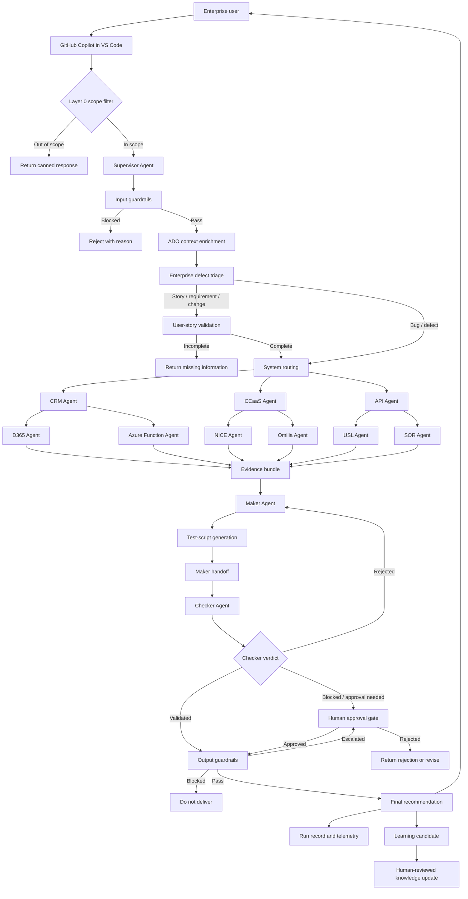

# Copilot Resolution Hub: End-to-End Flow

## Purpose

This document explains how a request moves through the Copilot Resolution Hub from the first user message to the final recommendation. It describes each part of the flow, the responsibility of the component, the evidence it consumes, the output it produces, and the conditions that stop or redirect the run.

The flow supports two primary request types:

- **Defect mode:** investigate a bug, incident, regression, or failed validation and recommend the smallest safe fix.
- **Development mode:** validate a user story, requirement, or change request and recommend or implement work against observable acceptance criteria.

The architecture is Markdown-driven. Agent definitions and skills describe the decision rules and contracts; MCP tools provide authoritative external evidence; the Supervisor coordinates the run.

## One-Line Flow

```text
User request
  -> Layer 0 scope filter
  -> Supervisor input guardrails
  -> ADO enrichment
  -> triage and request-type validation
  -> domain routing
  -> specialist investigation
  -> knowledge-base and MCP evidence
  -> Maker proposal
  -> test-script generation
  -> Checker validation
  -> output guardrails
  -> human approval when required
  -> final recommendation
  -> observability and learning records
```

## Main Flow Diagram



## Part 1: User Intake

### What happens

An enterprise user submits a request in GitHub Copilot Agent mode. Typical inputs are:

- An ADO bug or defect ID.
- An ADO user story ID.
- A change request.
- A requirement or a natural-language description containing system clues.

A typical defect prompt is:

```text
Analyse ADO bug <BUG_ID> and provide a fix recommendation.
```

### What the flow needs

The request should contain enough information to identify the work item and target system. The Supervisor can ask for the minimum missing detail when routing is ambiguous.

### Output

The initial request becomes the run input. The run should retain the work-item or task identifier so later evidence and the final recommendation can be checked against the same task.

## Part 2: Layer 0 Pre-LLM Scope Filter

### What happens

The deterministic scope filter checks whether the request contains an in-scope signal before an LLM call is made. In-scope signals include ADO work items, CRM, CCaaS, downstream APIs, D365, Azure Functions, NICE, Omilia, USL, SOR, MCP, pipelines, tests, and repository evidence.

If the request is clearly unrelated to this workspace, the filter returns the fixed response without routing or spending a model call:

> That question is outside this workspace and my role here as your coding assistant. I can help with ADO defects, user stories, and CRM / CCaaS / downstream API analysis in this repository.

### Decision

- **In scope:** continue to the Supervisor.
- **Out of scope:** stop and return the canned response.
- **Uncertain:** allow the model to continue to the normal input scope validation so a clarification can be requested.

### Important boundary

The Layer 0 policy is defined in the I/O guardrails skill. It is intended to run as deterministic pre-processing outside the agent decision flow. Markdown instructions describe the required behavior but do not replace an infrastructure or host-level enforcement point.

## Part 3: Supervisor Entry and Input Guardrails

### What happens

The Supervisor Agent is the central coordinator. Before triage or delegation, it treats the request, ADO text, comments, logs, and enriched evidence as untrusted data and applies the input guardrails.

The input checks are:

1. **Prompt-injection detection:** block instruction overrides, role reassignment, embedded tool commands, and attempts to reveal prompts or credentials.
2. **Scope validation:** confirm the request belongs to CRM, CCaaS, or downstream API work.
3. **Secret and PII handling:** redact tokens, PATs, connection strings, authorization headers, and customer records. Raw sensitive values must not enter agent context.
4. **Input completeness:** for stories, requirements, and change requests, invoke user-story validation before routing.

### Decision

- **Security violation:** hard-block and report the reason.
- **Unknown system:** ask for clarification instead of guessing.
- **Valid input:** continue to enrichment and triage.

### Output

The Supervisor creates a clean, bounded task context and records an input guardrail result containing the checks, violations, and decision without persisting secrets or raw customer data.

## Part 4: ADO Work-Item Enrichment

### What happens

For an ADO-driven request, the Supervisor reads the authoritative work-item context through the ADO MCP. The enrichment should include, when available:

- Title and description.
- Reproduction steps or acceptance criteria.
- Comments and system information.
- Attachments and linked work items.
- Related pull requests and commits.
- Environment or deployment details.

The Supervisor uses this information for classification and routing metadata. It does not perform deep technical root-cause analysis.

### Output

The enriched task context contains the work-item facts needed by triage, including the task identifier, request type, system clues, and missing information.

## Part 5: Triage and Operating Mode

### What happens

The Enterprise Defect Triage skill summarizes the request, identifies the input type, extracts system clues, classifies the target domain, names the likely specialist, and records missing information.

The flow then selects one operating mode:

### Defect mode

Used for bugs, incidents, regressions, and failed validation. The run must establish:

- A baseline of the current failure.
- One falsifiable root-cause hypothesis.
- The narrowest evidence that could disprove that hypothesis.
- A primary validation metric.

### Development mode

Used for user stories, requirements, and approved change requests. The run must establish:

- Observable acceptance criteria.
- Scenarios and fixed constraints.
- Baseline behavior.
- A primary acceptance metric.

The two modes have different success criteria and should not be blended.

### Output

The triage result contains the target system, route decision, confidence level, request mode, and missing data.

## Part 6: User-Story Validation Branch

### When it runs

This branch runs for a user story, requirement, or change request. It does not run as a blocking prerequisite for a defect that already has enough evidence to investigate.

### What it checks

The User Story Validation skill checks that the request has:

- Acceptance criteria.
- Observable scenarios.
- Scope and fixed constraints.
- Enough detail to identify the target system and expected behavior.

### Decision

- **Complete:** continue to system routing.
- **Incomplete:** return the missing fields to the requester and do not route.
- **Blocked dependency:** escalate the blocking reason to the Human Approval Gate.

This prevents an agent from inventing acceptance criteria or making an implementation recommendation against an underspecified request.

## Part 7: Domain Routing

### What happens

The System Routing skill maps the task to exactly one primary domain agent whenever possible:

| Target domain | Domain agent | Specialist choices |
| --- | --- | --- |
| CRM | CRM Agent | D365 Agent or Azure Function Agent |
| CCaaS | CCaaS Agent | NICE Agent or Omilia Agent |
| Downstream API | API Agent | USL Agent or SOR Agent |

The domain agent owns coordination within its area. The Supervisor does not perform the specialist diagnosis itself.

### Specialist selection

- **D365 Agent:** Dataverse, entities, plugins, and business rules.
- **Azure Function Agent:** Azure Functions, bindings, integrations, and deployment concerns.
- **NICE Agent:** routing, IVR, queues, and scripts.
- **Omilia Agent:** intents, NLU, entities, and dialogue.
- **USL Agent:** USL service issues, integrations, and API troubleshooting.
- **SOR Agent:** SOR backend behavior and service-fix recommendations.

### Output

The routing result records the primary agent, any justified secondary agent, the reason for selection, and the routing confidence.

## Part 8: Repository and Knowledge-Base Lookup

### What happens

Before using an MCP to retrieve source code or scripts, the specialist checks `docs/knowledge-base-registry.md` for a matching domain and component.

- If the knowledge-base entry exists, the specialist resolves the file from the approved repository and branch locally.
- If the required evidence is not present locally, the specialist uses the appropriate approved MCP.
- The evidence summary must state whether each source came from the local knowledge base or an MCP.

This rule is especially important for NICE and Omilia analysis because it avoids speculative or unnecessarily expensive source extraction.

### Output

The specialist has a source location, repository and branch context, and an evidence path before making a diagnosis.

## Part 9: MCP Governance and Evidence Gathering

### What happens

The selected specialist gathers authoritative evidence through the narrowest read-only MCP that can answer the question. The evidence can include code, configuration, logs, deployment state, API behavior, or test results.

The specialist must follow the MCP inspection inventory and access controls:

- Use dedicated read-only service accounts or PAT users.
- Do not use personal write-capable credentials.
- Do not treat PAT scope alone as a sufficient control.
- Do not call a blocked MCP for restricted code extraction.
- Escalate or supply manual context when the approved evidence path is unavailable.

The Omilia MCP is currently marked blocked for code extraction in the inspection inventory. The interim path is local knowledge-base evidence or manually supplied context.

### Evidence bundle

The specialist packages facts with their sources and references. The bundle should separate:

- **Facts:** directly observed evidence.
- **Inferences:** conclusions supported by those facts.
- **Unknowns:** evidence that is unavailable or still needs confirmation.

A specialist recommendation must not rely on an invented file path, fabricated log value, or unsupported root cause.

## Part 10: End-to-End Failure Tracing

### What happens in defect mode

The specialist traces the reported behavior across the smallest relevant path:

```text
Entry API or function
  -> request or event handling
  -> service or business logic
  -> integration or data layer
  -> downstream dependency
  -> observed failure
```

The specialist compares the baseline behavior with the expected behavior, identifies the first point where they diverge, and tests one root-cause hypothesis against authoritative evidence.

### What the specialist produces

- One-line problem summary.
- Root cause and confidence level.
- Affected repository, branch, files, and components.
- Minimal proposed change.
- Targeted tests and validation checks.
- Risk and rollback considerations.

For a bug, the repository unit-test gate is part of completion. If unit tests cannot be identified or executed, the recommendation is marked blocked with the reason.

## Part 11: Maker Agent Proposal

### What happens

The Maker Agent turns the evidence bundle into the smallest safe, evidence-backed recommendation. It may propose a code change, configuration change, test change, or a request for additional evidence, depending on the mode and risk.

The proposal must include:

- Problem summary.
- Suspected root cause.
- Recommended fix.
- Affected files or components.
- Primary metric.
- Tests and validation plan.
- Risk and rollback considerations.
- Knowledge candidate, when a reusable procedure was discovered.

The Maker owns the proposal but cannot self-certify it.

## Part 12: Test-Script Generation

### What happens

After the Maker proposal, the Test Script Generation skill prepares the validation surface:

- **Defect fix:** locate existing tests for the changed components and identify coverage gaps.
- **New development:** generate test cases from the validated acceptance criteria.

The validation plan should contain the narrowest checks capable of disproving the proposal, followed by the repository unit-test command required by the fix recommendation skill.

### Output

The test stage returns existing test references, generated cases where applicable, identified gaps, and executable validation commands.

## Part 13: Maker Handoff

### What happens

The Maker packages the proposal into a structured handoff for the Checker. The handoff carries the identity and evidence needed for independent validation.

A handoff includes:

```yaml
task_id: <work-item-or-task-id>
mode: defect | development
primary_metric: <observable-success-measure>
scope: <bounded-change-scope>
evidence: <facts-and-sources>
hypothesis: <falsifiable-hypothesis>
proposal: <minimal-recommended-change>
validation_plan: <tests-and-negative-checks>
knowledge_candidate: <optional-reusable-procedure>
```

The Checker evaluates this handoff; it does not silently rewrite it.

## Part 14: Checker Agent Validation

### What happens

The Checker independently verifies:

- The evidence supports the root-cause hypothesis.
- The proposed files and components are in scope.
- The primary metric is meaningful and measured.
- Negative checks or regression checks exist.
- Unit tests and targeted checks are identified and pass where required.
- The approval triggers have been considered.

### Verdicts

| Verdict | Meaning | Next step |
| --- | --- | --- |
| `validated` | Evidence and validation support the Maker proposal. | Continue to approval and output checks. |
| `rejected` | The proposal is not supported or fails a check. | Return to the Maker with the reason. |
| `blocked` | Required evidence or validation is unavailable. | Escalate or request the missing input. |
| `needs_human_approval` | The change or uncertainty requires a human decision. | Stop at the approval gate. |

Two consecutive rejected proposals, unresolved cross-system evidence conflicts, or high-risk low-confidence work can trigger higher-capability model re-validation.

## Part 15: Human Approval Gate

### When approval is required

The flow stops for human review when the recommendation involves:

- Cross-system business logic.
- Authentication or authorization.
- Data integrity or customer-facing routing.
- Production configuration.
- Low-confidence root-cause analysis.
- Security-sensitive or destructive actions.

### What the human decides

The approval request states:

- Why approval is needed.
- What decision the reviewer must make.
- Which evidence supports the recommendation.
- What risk, rollback, and validation plan applies.

An approval does not turn an unsupported recommendation into a validated one. The Checker evidence and the approval decision remain separate records.

## Part 16: Output Guardrails

### What happens

After the Checker verdict and any required approval, the Supervisor consolidates the result and applies output guardrails before delivery.

The checks are:

1. **Sensitive-data scan:** no secrets, PATs, raw production payloads, or customer data.
2. **Evidence grounding:** every root cause, file, line reference, and fix must trace to the evidence bundle.
3. **Write and risk gate:** production, security, data-integrity, destructive, or unapproved write actions must go through approval.
4. **Output contract:** required recommendation sections are present.
5. **Relevancy:** the result addresses the same task, reported symptom or acceptance criteria, and routed domain.

### Decision

- **Security violation:** hard-block delivery.
- **Weak grounding, malformed contract, or irrelevant result:** flag and escalate for correction or approval.
- **Pass:** deliver the final recommendation.

## Part 17: Final Recommendation

A completed bug recommendation contains:

1. Bug summary.
2. Target system and owning repository.
3. Root cause and confidence.
4. Exact change locations.
5. Patch summary.
6. Validation results and unit-test outcome.
7. SIT validation checklist.
8. Risks and rollback plan.
9. Ready-to-paste ADO comment.
10. Approval status.
11. Observability run-record reference.

A completed development recommendation contains the validated acceptance criteria, proposed implementation scope, affected components, test cases, measured result, risks, and approval status.

The final response is a recommendation and validation record. Production or destructive changes remain subject to the applicable human approval and deployment controls.

## Part 18: Observability

### What happens

Each defect run produces a structured run record. The run record has one trace per work item and spans for the important transitions:

- Input and output guardrail verdicts.
- Supervisor and domain-agent hops.
- Specialist investigation.
- MCP evidence calls.
- Maker proposal.
- Checker verdict.
- Model escalation.
- Human approval.
- Final consolidation.

The telemetry exporter sends redacted records to Logfire or another OTLP backend. Observability is post-hoc telemetry: it records what happened but does not participate in routing or approval decisions.

### Redaction rule

Do not emit secrets, PATs, connection strings, customer records, raw production payloads, or other sensitive values in span names, attributes, or events.

The final recommendation should reference the run ID, span count, and emit target when those values are available.

## Part 19: Learning Loop

### What happens

After a validated fix, the run produces an append-only evaluation or procedure-learning candidate. The candidate records reusable, non-sensitive knowledge such as:

- Task or bug identifier.
- Symptom pattern.
- Root-cause pattern.
- Minimal fix pattern.
- Unit-test command and result.
- Regression checks.

A human-reviewed change promotes the lesson into `.github/skills/fix-recommendation/PROCEDURE-LEARNING.md`. Rejected or unverified lessons are not promoted.

### Why it matters

The learning loop improves future recommendations without allowing an unverified result to become agent guidance. Evidence and review remain prerequisites for promotion.

## Stop, Loop, and Escalation Conditions

| Condition | Flow behavior |
| --- | --- |
| Clearly out-of-scope request | Layer 0 returns the canned response; no model call or routing. |
| Prompt injection, secret, PII, or unapproved destructive action | Hard-block; do not propagate the unsafe content. |
| Unknown target system | Ask for the minimum clarification; do not guess. |
| Incomplete story or requirement | Return missing acceptance criteria, scenarios, or scope; do not route. |
| MCP unavailable or blocked | Use approved local/manual evidence or mark the run blocked. |
| Weak or ungrounded Maker proposal | Checker rejects it and sends it back to Maker. |
| Missing required validation | Mark blocked or rejected; do not claim validated. |
| High-risk or low-confidence recommendation | Stop at Human Approval Gate. |
| Output contract or relevancy failure | Escalate for correction before delivery. |
| Validated low-risk recommendation | Deliver the final recommendation and record learning/observability data. |

## Component Reference Map

| Flow part | Repository implementation or source of truth |
| --- | --- |
| Global operating rules | [copilot-instructions.md](../copilot-instructions.md) |
| Supervisor coordination | [supervisor-agent.md](../.github/agents/supervisor-agent.md) |
| Domain agents | [CRM](../.github/agents/crm-agent.md), [CCaaS](../.github/agents/ccaas-agent.md), [API](../.github/agents/api-agent.md) |
| Specialist agents | [D365](../.github/agents/d365-agent.md), [Azure Function](../.github/agents/azure-function-agent.md), [NICE](../.github/agents/nice-agent.md), [Omilia](../.github/agents/omilia-agent.md), [USL](../.github/agents/usl-agent.md), [SOR](../.github/agents/sor-agent.md) |
| Triage | [enterprise-defect-triage](../.github/skills/enterprise-defect-triage/SKILL.md) |
| User-story validation | [user-story-validation](../.github/skills/user-story-validation/SKILL.md) |
| System routing | [system-routing](../.github/skills/system-routing/SKILL.md) |
| Input and output guardrails | [io-guardrails](../.github/skills/io-guardrails/SKILL.md) |
| MCP governance | [mcp-governance](../.github/skills/mcp-governance/SKILL.md) |
| Fix recommendation | [fix-recommendation](../.github/skills/fix-recommendation/SKILL.md) |
| Test generation | [test-script-generation](../.github/skills/test-script-generation/SKILL.md) |
| Human approval | [human-approval](../.github/skills/human-approval/SKILL.md) |
| Observability | [agent-observability](../.github/skills/agent-observability/SKILL.md) and [observability README](../observability/README.md) |
| ADO prompt and output contract | [enterprise-bug-end-to-end-prompts.md](enterprise-bug-end-to-end-prompts.md) |
| Architecture diagram | [enterprise-agent-architecture.md](enterprise-agent-architecture.md) |

## Example: Defect Run in Practice

For a prompt such as `Analyse ADO bug 879652 and provide a fix recommendation`:

1. The scope filter recognizes an in-scope ADO defect request.
2. The Supervisor validates the input and reads the ADO work item.
3. Triage identifies defect mode and extracts CRM, CCaaS, or API clues.
4. The Supervisor routes to the matching domain agent.
5. The domain agent selects the specialist and checks the knowledge-base registry.
6. The specialist uses local repository evidence or an approved read-only MCP.
7. The specialist creates an evidence bundle and traces the failure path.
8. The Maker proposes a minimal fix and validation plan.
9. Existing tests are located and coverage gaps are recorded.
10. The Checker independently validates the proposal.
11. High-risk work pauses for human approval; low-risk validated work continues.
12. Output guardrails check grounding, relevancy, sensitive data, and the response contract.
13. The Supervisor returns the recommendation with validation, SIT, rollback, ADO, and run-record details.
14. A reviewed procedure lesson can be promoted for future runs.
