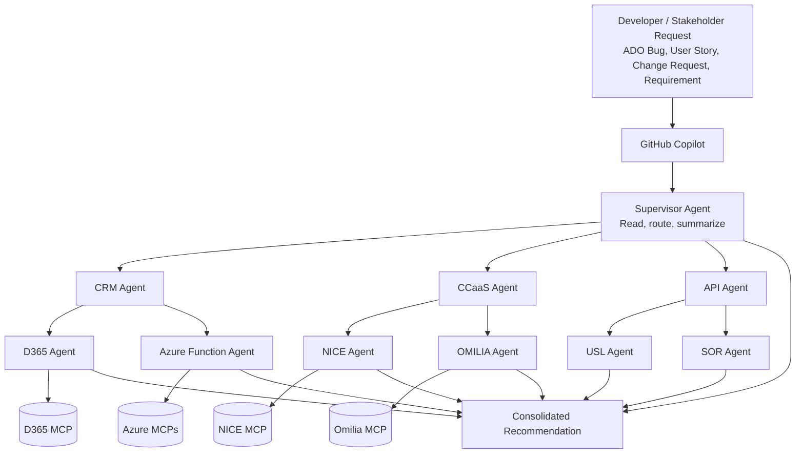

# Enterprise Copilot Agent Architecture

## 0. End-to-End Flow Diagram (Full Architecture — updated 19 Aug 2026)

```mermaid
flowchart TD
    %% ── Entry ──────────────────────────────────────────────────────────────
    USER(["`**Enterprise User**
    Ops · QA · Developer · Support`"])
    COPILOT["`**GitHub Copilot**
    VS Code · Agent mode`"]
    USER -->|ADO Bug ID / User Story / Change Request / Requirement| COPILOT

    %% ── Layer 0: deterministic pre-LLM scope filter ─────────────────────────
    COPILOT --> PREFILTER{"`**Layer 0 — Pre-LLM Scope Filter**
    Deterministic · no model call
    Allow-list vs off-topic reject-list`"}
    PREFILTER -->|off-topic — no model call| CANNED[/"Canned out-of-scope reply\nreturned verbatim"/]
    PREFILTER -->|in-scope| SUP

    %% ── Supervisor ──────────────────────────────────────────────────────────
    COPILOT --> SUP["`**Supervisor Agent**
    Normalise · Enrich · Coordinate`"]
    SUP -->|Enrich work item| ADO[(ADO MCP)]
    ADO -->|Work item metadata| SUP

    %% ── Input guardrails ────────────────────────────────────────────────────
    SUP --> INGUARD{"`**Input Guardrails**
    Injection · Scope · Secret/PII`"}
    INGUARD -->|blocked — security violation| GBLOCK[/Reject + report reason\nDo not route/]
    INGUARD -->|pass| TRIAGE

    %% ── Triage gate ─────────────────────────────────────────────────────────
    SUP --> TRIAGE{"`**Enterprise Defect
    Triage Skill**
    Input type?`"}

    %% ── User story validation branch ────────────────────────────────────────
    TRIAGE -->|User Story / Requirement / Change Request| USV["`**User Story Validation Skill**
    Check: acceptance criteria · scenarios · scope`"]
    USV --> USVGATE{Complete?}
    USVGATE -->|INCOMPLETE — gaps found| GAPS[/Return gaps to requester\nDo not route/]
    USVGATE -->|BLOCKED — dependency unresolvable| HAPRE["`**Human Approval Gate**
    Escalate blocking reason`"]

    %% ── Bug / defect straight to routing ────────────────────────────────────
    TRIAGE -->|Bug / Defect| ROUTE

    %% ── Routing ─────────────────────────────────────────────────────────────
    USVGATE -->|COMPLETE| ROUTE["`**System Routing Skill**
    Select domain agent`"]

    ROUTE -->|CRM| CRM["`**CRM Agent**`"]
    ROUTE -->|CCaaS| CCAAS["`**CCaaS Agent**`"]
    ROUTE -->|Downstream API| API["`**API Agent**`"]

    %% ── CRM specialists ─────────────────────────────────────────────────────
    CRM --> D365["`**D365 Agent**`"]
    CRM --> AZF["`**Azure Function Agent**`"]

    %% ── CCaaS specialists ───────────────────────────────────────────────────
    CCAAS --> NICE["`**NICE Agent**`"]
    CCAAS --> OMIL["`**Omilia Agent**`"]

    %% ── API specialists ─────────────────────────────────────────────────────
    API --> USL["`**USL Agent**`"]
    API --> SOR["`**SOR Agent**`"]

    %% ── Knowledge base lookup (all specialists) ─────────────────────────────
    D365 & AZF & NICE & OMIL & USL & SOR --> KBCHECK{"`**Knowledge Base
    Lookup**
    docs/knowledge-base-registry.md`"}

    KBCHECK -->|Found in local KB repo| LOCALCODE[("`Local GitHub
    Repo Clone`")]
    LOCALCODE -->|Evidence resolved locally| EVIDENCE

    KBCHECK -->|Not in local KB| MCPGUARD{"`**MCP Guardrail**
    Check inspection status`"}

    %% ── MCP guardrail ───────────────────────────────────────────────────────
    MCPGUARD -->|approved / restricted| MCPS

    subgraph MCPS [" Approved MCP Evidence Sources "]
        direction LR
        D365MCP[(D365 MCP)]
        AZMCP[(Azure MCPs)]
        NICEMCP[("NICE MCP ✅
        read-only PAT")]
        OMILMCP[("Omilia MCP 🚫
        BLOCKED — PAT bypass")]
        APIMCP[(USL · SOR MCP)]
    end

    MCPGUARD -->|blocked — Omilia PAT bypass| MANUALCTX[/Supply code to agent
    context manually/]
    MANUALCTX --> EVIDENCE

    MCPS --> EVIDENCE["`**Evidence Bundle**
    Facts · source · reference`"]

    %% ── Maker agent ─────────────────────────────────────────────────────────
    EVIDENCE --> MAKER["`**Maker Agent**
    Form hypothesis · minimal proposal
    scope · risks · validation plan`"]

    MAKER --> TSG["`**Test Script Generation Skill**
    Defect: locate existing tests · find gaps
    New dev: generate from acceptance criteria`"]

    TSG --> HANDOFF["`**Maker Handoff YAML**
    task_id · mode · primary_metric
    scope · evidence · hypothesis
    proposal · validation_plan · knowledge_candidate`"]

    %% ── Checker agent ───────────────────────────────────────────────────────
    HANDOFF --> CHECKER["`**Checker Agent**
    Independent validation
    Cannot modify Maker proposal`"]

    CHECKER --> VERDICT{Checker verdict}

    VERDICT -->|validated| HAPGATE{"`**Human Approval
    Gate**
    High-risk?`"}
    VERDICT -->|rejected| MAKER
    VERDICT -->|blocked / needs_human_approval| HAPGATE

    %% ── Human approval ──────────────────────────────────────────────────────
    HAPGATE -->|Production · Security · Data integrity · Cross-system| HUMAN[/Human Reviewer\nApproves or rejects/]
    HAPGATE -->|Low risk — no approval needed| RESULT

    HUMAN -->|Approved| RESULT
    HUMAN -->|Rejected| MAKER

    %% ── Output guardrails ───────────────────────────────────────────────────
    RESULT --> OUTGUARD{"`**Output Guardrails**
    Secret scan · Grounding · Relevancy · Write-risk`"}
    OUTGUARD -->|blocked — security violation| GBLOCK
    OUTGUARD -->|flag — quality violation| HAPGATE
    OUTGUARD -->|pass| USER

    %% ── Output ──────────────────────────────────────────────────────────────
    RESULT["`**Consolidated Recommendation**
    Root cause · affected files
    Fix · test commands · risks`"]

    RESULT --> USER

    %% ── Learning loop ───────────────────────────────────────────────────────
    RESULT --> LEARN["`**Learning Loop**
    Append-only evaluation record`"]
    LEARN --> PROMOTE{Human review PR}
    PROMOTE -->|Approved| KB["`PROCEDURE-LEARNING.md
    Versioned knowledge base`"]
    PROMOTE -->|Rejected| DISCARD[/Discard — not promoted/]

    %% ── Styles ──────────────────────────────────────────────────────────────
    classDef userStyle    fill:#EAF2F8,stroke:#2471A3,color:#1B2631,stroke-width:2px
    classDef copilotStyle fill:#D6EAF8,stroke:#2874A6,color:#1B2631,stroke-width:2px
    classDef agentStyle   fill:#E8DAEF,stroke:#7D3C98,color:#1B2631,stroke-width:1px
    classDef skillStyle   fill:#FEF9E7,stroke:#B7950B,color:#1B2631,stroke-width:1px
    classDef mcpStyle     fill:#F4ECF7,stroke:#8E44AD,color:#1B2631,stroke-width:1px
    classDef gateStyle    fill:#FDEBD0,stroke:#D35400,color:#1B2631,stroke-width:1px
    classDef resultStyle  fill:#D5F5E3,stroke:#1E8449,color:#1B2631,stroke-width:2px
    classDef blockedStyle fill:#FADBD8,stroke:#C0392B,color:#1B2631,stroke-width:1px
    classDef learnStyle   fill:#D1F2EB,stroke:#148F77,color:#1B2631,stroke-width:1px

    class USER,COPILOT userStyle
    class SUP,CRM,CCAAS,API,D365,AZF,NICE,OMIL,USL,SOR agentStyle
    class TRIAGE,ROUTE,KBCHECK,MCPGUARD,USVGATE,VERDICT,HAPGATE,PROMOTE,INGUARD,OUTGUARD,PREFILTER gateStyle
    class USV,TSG skillStyle
    class MCPS,D365MCP,AZMCP,NICEMCP,APIMCP,ADO,LOCALCODE mcpStyle
    class OMILMCP,GBLOCK,CANNED blockedStyle
    class MAKER,CHECKER,HANDOFF copilotStyle
    class RESULT resultStyle
    class LEARN,KB,PROMOTE learnStyle
    class HAPRE,HUMAN,GAPS,MANUALCTX,DISCARD gateStyle
```



### Flow Key
| Symbol | Meaning |
| --- | --- |
| Rectangle | Agent or process step |
| Diamond `{}` | Decision gate or skill invocation |
| Cylinder `[()]` | MCP or data store |
| Rounded `([])` | User / external actor |
| Parallelogram `/` | Terminal output or action |
| ✅ | MCP approved / restricted (read-only PAT) |
| 🚫 | MCP blocked (do not use for code extraction) |

---

## 0a. Leadership Visual Mapping Diagram

Use this diagram when you need a simpler one-slide visual map for leadership. It shows the project as eight business stages instead of every technical decision branch.

```mermaid
flowchart LR
  %% ── Stage 1: Intake ───────────────────────────────────────────────────
  subgraph S1["1. Intake"]
    U["Business / QA / Developer"]
    IN["ADO Bug ID<br/>User Story<br/>Change Request"]
    U --> IN
  end

  %% ── Stage 2: Copilot Entry ────────────────────────────────────────────
  subgraph S2["2. Copilot Entry"]
    CP["GitHub Copilot<br/>VS Code Agent Mode"]
    SUP["Supervisor Agent<br/>Normalise + Coordinate"]
    CP --> SUP
  end

  %% ── Stage 3: Quality Gate ─────────────────────────────────────────────
  subgraph S3["3. Quality Gate"]
    ADO["ADO MCP<br/>Work Item Context"]
    TRIAGE["Defect Triage Skill"]
    STORY["User Story Validation<br/>AC + Scenarios + Scope"]
    ADO --> TRIAGE
    TRIAGE --> STORY
  end

  %% ── Stage 4: Routing ──────────────────────────────────────────────────
  subgraph S4["4. Domain Routing"]
    CRM["CRM Agent"]
    CCAAS["CCaaS Agent"]
    API["API Agent"]
  end

  %% ── Stage 5: Specialist Diagnosis ─────────────────────────────────────
  subgraph S5["5. Specialist Diagnosis"]
    D365["D365"]
    AZF["Azure Function"]
    NICE["NICE"]
    OMIL["Omilia"]
    USL["USL"]
    SOR["SOR"]
  end

  %% ── Stage 6: Evidence Layer ───────────────────────────────────────────
  subgraph S6["6. Evidence Layer"]
    KB["Knowledge Base First<br/>GitHub-hosted code repos"]
    MCP["Approved MCPs<br/>Read-only evidence"]
    GUARD["MCP Guardrails<br/>PAT + access controls"]
    KB --> MCP
    MCP --> GUARD
  end

  %% ── Stage 7: Recommendation Engine ────────────────────────────────────
  subgraph S7["7. Recommendation Engine"]
    MAKER["Maker Agent<br/>Hypothesis + minimal fix"]
    TEST["Test Script Generation<br/>Existing tests or generated tests"]
    CHECKER["Checker Agent<br/>Independent validation"]
    MAKER --> TEST --> CHECKER
  end

  %% ── Stage 8: Controlled Output ────────────────────────────────────────
  subgraph S8["8. Controlled Output"]
    APPROVAL["Human Approval Gate<br/>Production / risk / security"]
    REC["Final Recommendation<br/>Root cause + fix + tests + risks"]
    LEARN["Learning Loop<br/>Procedure knowledge base"]
    APPROVAL --> REC --> LEARN
  end

  %% ── Cross-stage flow ──────────────────────────────────────────────────
  IN --> CP
  SUP --> ADO
  TRIAGE --> CRM
  TRIAGE --> CCAAS
  TRIAGE --> API

  CRM --> D365
  CRM --> AZF
  CCAAS --> NICE
  CCAAS --> OMIL
  API --> USL
  API --> SOR

  D365 --> KB
  AZF --> KB
  NICE --> KB
  OMIL --> KB
  USL --> KB
  SOR --> KB

  GUARD --> MAKER
  CHECKER --> APPROVAL

  %% ── Notes ─────────────────────────────────────────────────────────────
  STORY -. incomplete .-> BACK["Return gaps<br/>before routing"]
  CHECKER -. rejected .-> MAKER
  LEARN -. approved lesson .-> KB

  %% ── Styling ───────────────────────────────────────────────────────────
  classDef intake fill:#EAF2F8,stroke:#2471A3,color:#17202A,stroke-width:1px;
  classDef copilot fill:#D6EAF8,stroke:#2874A6,color:#17202A,stroke-width:1px;
  classDef gate fill:#FDEBD0,stroke:#D35400,color:#17202A,stroke-width:1px;
  classDef agent fill:#E8DAEF,stroke:#7D3C98,color:#17202A,stroke-width:1px;
  classDef evidence fill:#F4ECF7,stroke:#8E44AD,color:#17202A,stroke-width:1px;
  classDef output fill:#D5F5E3,stroke:#1E8449,color:#17202A,stroke-width:1px;
  classDef warning fill:#FADBD8,stroke:#C0392B,color:#17202A,stroke-width:1px;

  class U,IN intake;
  class CP,SUP copilot;
  class ADO,TRIAGE,STORY,GUARD,APPROVAL gate;
  class CRM,CCAAS,API,D365,AZF,NICE,OMIL,USL,SOR,MAKER,CHECKER,TEST agent;
  class KB,MCP evidence;
  class REC,LEARN output;
  class BACK warning;
```



### Leadership Talking Track

1. **One intake point:** users provide an ADO ID or requirement in Copilot Chat.
2. **Governed routing:** the Supervisor enriches the item and routes it to the correct domain.
3. **Knowledge base first:** agents search approved GitHub code repositories before calling MCPs, reducing token usage.
4. **Evidence-backed recommendation:** the Maker Agent proposes; the Checker Agent validates independently.
5. **Controlled release:** high-risk changes go through human approval, then validated lessons feed the learning loop.

---

## 0b. High-Level Block Diagram



### Demo Legend
- **Copilot**: the user-facing entry point.
- **Supervisor Agent**: routes and coordinates only.
- **Domain Agents**: CRM, CCaaS, and API.
- **Sub-Agents**: specialist diagnosis layers for D365, Azure Functions, NICE, OMILIA, USL, and SOR.
- **MCPs**: authoritative evidence sources used by the specialists.
- **Consolidated Recommendation**: the final output for the developer or stakeholder.

## 1. Folder Hierarchy

```text
Copilot Resolution Hub/
  copilot-instructions.md
  .github/
    agents/
      supervisor-agent.md
      crm-agent.md
      ccaas-agent.md
      api-agent.md
      d365-agent.md
      azure-function-agent.md
      nice-agent.md
      omilia-agent.md
      usl-agent.md
      sor-agent.md
    skills/
      enterprise-defect-triage/SKILL.md
      system-routing/SKILL.md
      mcp-governance/SKILL.md
      fix-recommendation/SKILL.md
      human-approval/SKILL.md
  docs/
    enterprise-agent-architecture.md
```

## 2. Agent Responsibilities

### Supervisor Agent
Coordinates the flow only. Reads the request, determines the likely domain, delegates, collects responses, and summarizes. It does not perform deep analysis.

### CRM Agent
Owns CRM triage and routes to D365 or Azure Function specialists.

### CCaaS Agent
Owns contact-center triage and routes to NICE or OMILIA specialists.

### API Agent
Owns downstream API triage and routes to USL or SOR specialists.

### D365 Agent
Investigates Dataverse, entities, plugins, and business rules using the D365 MCP.

### Azure Function Agent
Investigates function app defects, API integration issues, and deployment recommendations using Azure MCPs.

### NICE Agent
Investigates routing, IVR, queue, and script defects using the NICE MCP.

### OMILIA Agent
Investigates intent, NLU, entity, and dialogue defects using the Omilia MCP.

### USL Agent
Investigates service integration, API troubleshooting, and dependency behavior for USL.

### SOR Agent
Investigates backend service defects and recommends service fixes for SOR.

### Maker Agent
Produces a bounded, evidence-backed defect recommendation or development proposal. It must hand its proposal to a separate Checker Agent and cannot certify its own work.

### Checker Agent
Independently validates the Maker handoff, including evidence, primary metric, negative checks, scope, and approval gates. It returns a verdict but never rewrites the Maker proposal.

## 3. Agent-to-Agent Invocation Rules

1. The Supervisor Agent is the only entry point.
2. The Supervisor Agent routes to one primary domain agent.
3. The domain agent may route to exactly one specialist sub-agent for focused analysis.
4. Specialist agents do not route laterally to other domains unless the domain agent approves it.
5. A specialist or domain agent sends evidence to the Maker Agent, which returns a versioned proposal handoff.
6. The Checker Agent independently validates that handoff before the Supervisor aggregates the outcome.
7. No agent may bypass the established hierarchy to perform another agent's core job or act as both Maker and Checker for the same task attempt.

## 4. MCP Usage Rules

1. Use the narrowest MCP that can prove or disprove the hypothesis.
2. Prefer read-only access.
3. Keep MCP calls inside the specialist agent that owns the evidence.
4. Do not ask multiple MCPs for the same evidence unless the first source is incomplete.
5. If the work item already answers the question, do not call an MCP.

## 5. Example Prompts

- Analyze ADO bug 12345 and determine whether the defect belongs to CRM, CCaaS, or downstream API.
- Read user story 67890, identify the likely system, and recommend the smallest safe fix.
- Investigate this change request, delegate to the right agent, and return affected files and validation steps.
- Determine whether this requirement should be handled by D365 or Azure Function analysis.

## 6. Example Execution Flow

### Phase 1: CRM Small Win
ADO Bug -> Supervisor Agent -> CRM Agent -> D365 Agent -> D365 MCP -> fix recommendation.

### Phase 2: CCaaS
ADO Bug -> Supervisor Agent -> CCaaS Agent -> NICE Agent or OMILIA Agent -> MCP evidence -> fix recommendation.

### Phase 3: API
ADO Bug -> Supervisor Agent -> API Agent -> USL Agent or SOR Agent -> service evidence -> fix recommendation.

### Phase 4: Full Enterprise Supervisor
GitHub Copilot -> Supervisor Agent -> CRM, CCaaS, or API Agent -> specialist sub-agents -> MCPs -> consolidated response.

## 7. Best Practices

- Keep one responsibility per agent.
- Encode routing logic in markdown, not code.
- Make outputs structured and repeatable.
- Require evidence for every recommendation.
- Prefer small, reversible fixes.
- Preserve human approval for high-risk changes.
- Keep terminology aligned with business systems and ADO work items.

## 8. Enterprise Governance Model

- Owner: platform engineering or Copilot enablement team.
- Change control: update markdown instructions and skills through reviewable pull requests.
- Auditability: each agent must cite the evidence it used.
- Least privilege: agents should only access the MCPs needed for their scope.
- Separation of duties: supervisor coordinates, domain agents analyze, specialists diagnose.
- Versioning: track behavior changes in markdown files rather than source code.

## 9. Human Approval Checkpoints

- Production-impacting code changes.
- Cross-system contract changes.
- Security, identity, or data integrity changes.
- Low-confidence diagnosis.
- Any recommendation that changes routing behavior or customer experience.

## 10. Recommended GitHub Repository Structure

```text
copilot-resolution-hub/
  copilot-instructions.md
  .github/
    agents/
    skills/
  docs/
    enterprise-agent-architecture.md
  README.md
```

Recommended additions for future phases:
- `docs/mcp-inventory.md` for MCP ownership and access notes.
- `docs/decision-records/` for architecture decisions.
- `examples/` for prompt templates and sample outputs.

## 11. Codification Roadmap (agreed 19 Aug 2026)

### Current Phase: Markdown-First (Rapid Development)
All agent behaviour is defined in Markdown files (`.github/agents/`, `.github/skills/`). This provides rapid iteration — changing agent behaviour requires only editing a Markdown file, with no build or deployment cycle.

**When to stay in Markdown:**
- The workflow is still being proven or adjusted.
- New agents, skills, or routing rules are being validated through live use.
- The team needs to iterate quickly across multiple stakeholders.

### Next Phase: Codification (Precision Control)
Once a workflow is stable and proven, codify it into a language (Python, TypeScript, or similar) for finer control, testability, and reuse.

**Trigger criteria for codification:**
- The agent workflow has been validated in at least 5 real defect or development tasks.
- The Checker Agent has returned `validated` verdicts consistently.
- The team has identified specific Markdown limitations: e.g., conditional branching that is too complex, stateful context that Markdown cannot carry, or token efficiency issues from repeated instruction re-loading.

**What to codify first (priority order from 19 Aug 2026 review):**
1. Knowledge-base lookup logic (resolving code locally before MCP) — replaces ad-hoc Markdown instructions with a deterministic lookup function.
2. Routing logic (Supervisor → domain → specialist) — replace Markdown routing instructions with typed routing rules that can be unit-tested.
3. MCP access guardrails — enforce PAT scope and read-only rules programmatically rather than relying on agent instruction compliance.

**What stays in Markdown indefinitely:**
- Agent descriptions and domain knowledge (the "why" and "what to look for").
- MCP governance rules and approval gates.
- Human-approval checkpoint definitions.
- Skill documentation and procedure learning records.

**Decision record:** Sandip Nikumbha confirmed on 19 Aug 2026 that the Markdown-first approach is correct for the current phase. Codification begins once the task sequence is solidified and the team has validated the full flow.
