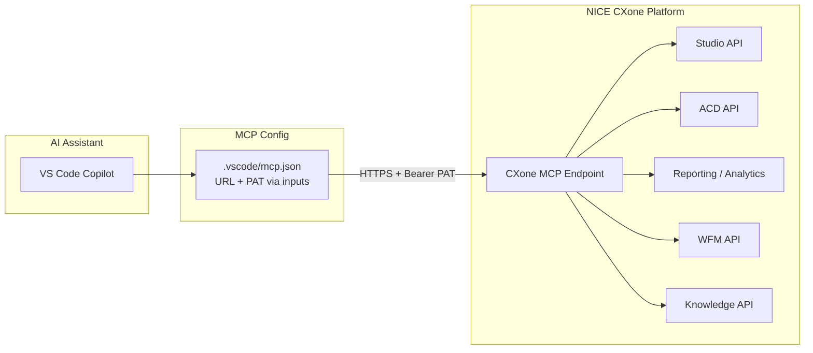
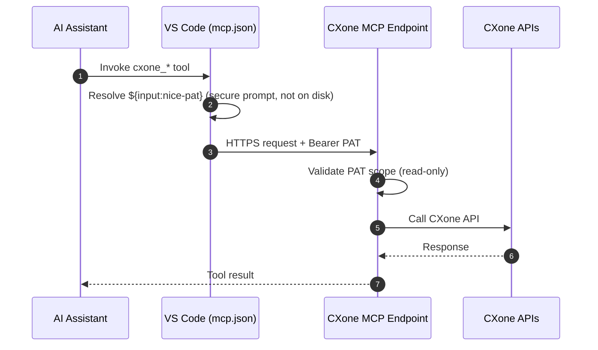

# NICE CXone MCP — Integration Design (Connect-Only)
**Version:** 2.0 | **Date:** 2026-08-26 | **Classification:** Internal – Architecture

> **Model:** Connect-only. Copilot connects to the NICE CXone MCP endpoint
> configured in [.vscode/mcp.json](../.vscode/mcp.json). No server code, Docker,
> or `.env` files are hosted in this repo. The full build-your-own reference
> (server code, Kubernetes, CI/CD) is intentionally omitted — see git history
> if a self-hosted server is ever required.
>
> **Client:** VS Code Copilot only. Other MCP clients (Claude Desktop, Cursor,
> ChatGPT) are out of scope by policy.
>
> **Runtime agent that uses these tools:** [.github/agents/nice-agent.md](../.github/agents/nice-agent.md)

---

## 1. Executive Summary

An MCP connection that lets **VS Code Copilot** interact with the NICE CXone
contact-center platform through governed, read-first tools — Studio scripts,
ACD routing, queue/agent metrics, WFM, analytics, and knowledge.

| Capability | Before | After |
|---|---|---|
| Script Review | Manual, days | AI-assisted, minutes |
| Routing Analysis | Expert-only | Self-serve via chat |
| ACD Config Audit | Spreadsheet | Live MCP tool call |
| Queue Metrics | CXone portal | Any AI assistant |
| Incident Triage | Ticket + portal | Copilot in VS Code |

**Scope:** Studio Scripts, ACD Routing, Agent/Queue Metrics, WFM Schedules,
Interaction Analytics, Knowledge, AI Agent config, Contact Flow docs.
**Out of scope:** Billing, HR data, PII beyond what CXone APIs authorize.

---

## 2. Architecture

### 2.1 Connection Overview



### 2.2 Auth & Security Boundary



**Security boundaries**
- **Secrets:** PAT supplied via `mcp.json` `inputs` (secure prompt); never written to the config file.
- **Transport:** TLS to the CXone endpoint.
- **Least privilege:** Use a dedicated read-only PAT (see `docs/mcp-inspection-inventory.md`).
- **Audit:** CXone-side API access logs; MCP Inspector governs onboarding.

---

## 3. Configuration

### 3.1 VS Code (`.vscode/mcp.json`) — the only supported client

```json
{
  "inputs": [
    {
      "id": "nice-pat",
      "type": "promptString",
      "description": "NICE CXone read-only PAT",
      "password": true
    }
  ],
  "servers": {
    "nice-mcp": {
      "type": "http",
      "url": "https://<nice-tenant>.nice-incontact.com/mcp",
      "headers": {
        "Authorization": "Bearer ${input:nice-pat}"
      }
    }
  }
}
```

> Replace `<nice-tenant>` with your CXone MCP host. Do not put the PAT in the
> file — the `${input:nice-pat}` reference prompts for it securely.

---

## 4. NICE CXone Tools

Tools this MCP exposes (prefix `cxone_`). Roles reflect least-privilege intent —
default to the read-only set.

| Tool | Description | Role |
|---|---|---|
| `cxone_get_studio_script` | Retrieve a Studio script by ID | `studio-reader` |
| `cxone_list_studio_scripts` | List scripts with filters | `studio-reader` |
| `cxone_analyze_script` | Analyze script quality / complexity | `studio-reader` |
| `cxone_document_contact_flow` | Generate flow documentation | `studio-reader` |
| `cxone_analyze_routing` | Analyze routing logic & flows | `routing-reader` |
| `cxone_get_acd_config` | Get ACD skills, queues, POCs | `acd-reader` |
| `cxone_optimize_flow` | Recommend routing optimizations | `routing-reader` |
| `cxone_get_agent_metrics` | Agent state & performance metrics | `reporting-reader` |
| `cxone_get_queue_metrics` | Queue/skill real-time or historical metrics | `reporting-reader` |
| `cxone_get_interaction_analytics` | Interaction-level analytics | `analytics-reader` |
| `cxone_get_wfm_schedules` | WFM agent schedules | `wfm-reader` |
| `cxone_search_knowledge` | Search knowledge base articles | `knowledge-reader` |
| `cxone_get_ai_agent_config` | AI Agent (Copilot) configuration | `ai-admin` |
| `cxone_create_studio_script` | Create a Studio script | `studio-writer` |
| `cxone_update_studio_script` | Update a Studio script | `studio-writer` |
| `cxone_generate_script` | Generate a script from description | `studio-writer` |

**Write-tool guidance:** Keep `studio-writer` / `ai-admin` tools disabled until a
change requires them. Any script create/update should pass through review before
being applied to a production tenant.

### 4.1 CXone API Reference Map

| Tool group | CXone API | Scope |
|---|---|---|
| Studio | `/studio/api/scripts/*` | `studio:read` / `studio:write` |
| Routing | `/routing/api/flows/*` | `routing:read` |
| ACD | `/acd/api/v1/skills` | `acd:read` |
| Reporting | `/reporting/api/v1/*` | `reporting:read` |
| Analytics | `/analytics/api/v1/interactions` | `analytics:read` |
| WFM | `/wfm/api/v1/schedules` | `wfm:read` |
| Knowledge | `/knowledge/api/v1/search` | `knowledge:read` |
| AI Agents | `/ai-agents/api/v1/agents` | `ai-agents:read` |

---

## 5. Security Model

| Control | Approach |
|---|---|
| Authentication | Bearer PAT (read-only) or OAuth client-credentials on the CXone side |
| Secret handling | `mcp.json` `inputs` (secure prompt) — no secrets on disk |
| Least privilege | Dedicated read-only PAT user; write scopes off by default |
| Transport | TLS to the CXone MCP endpoint |
| Governance | MCP Inspector review before adoption (`docs/mcp-governance` skill) |
| Audit | CXone API access logs + MCP inspection inventory record |

**Compliance notes**
- **PCI/GDPR:** Don't route cardholder data or PII beyond authorized API scopes.
- **PAT hygiene:** Rotate the read-only PAT on a schedule; store in a secret manager for shared use.
- **Inventory:** Record the server, tools, and status in `docs/mcp-inspection-inventory.md`.

---

## 6. Best Practices

1. **Read-first.** Adopt the read-only tool set; enable write tools only for a specific approved change.
2. **One PAT, least scope.** Use a dedicated read-only PAT user, not a personal token.
3. **Secure the secret.** Reference the PAT via `${input:...}`; never inline it in `mcp.json`.
4. **Review generated scripts.** Treat `cxone_generate_script` / `update` output as a draft that a human reviews before it touches production.
5. **Govern onboarding.** Run MCP Inspector and update the inspection inventory before agents rely on a new tool.
6. **Prefer the tool inventory over blind API calls** to keep token usage and blast radius small.

---

## 7. Adoption Roadmap

| Phase | Goal | Success Criteria |
|---|---|---|
| 1 – Connect | Add `nice-mcp` to `mcp.json`, supply read-only PAT | Copilot lists `cxone_*` read tools |
| 2 – Read tools | Use script/metrics/analytics read tools in daily triage | Analysts self-serve queue & routing questions |
| 3 – Governance | Record tools in inspection inventory, confirm least-privilege | All tools have an approved status |
| 4 – Controlled writes | Enable `studio-writer` for a scoped change with review | First reviewed script change applied via MCP |

**Risks & mitigations**

| Risk | Mitigation |
|---|---|
| PAT over-scoped | Use dedicated read-only PAT; verify scope during inspection |
| Generated script errors | Human review + validate against CXone schema before publish |
| Endpoint/API changes between CXone releases | Re-run MCP Inspector after upgrades; keep inventory current |
| Secret leakage | `${input:}` references only; rotate PAT regularly |

---

*Maintained by: Contact Center Platform Architecture Team.*
*Review: quarterly or on CXone API major-version changes.*
